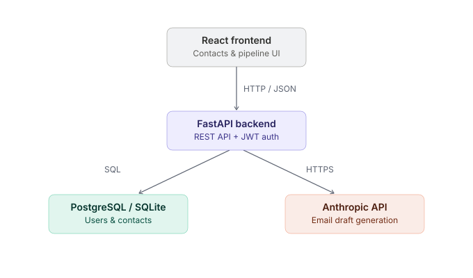
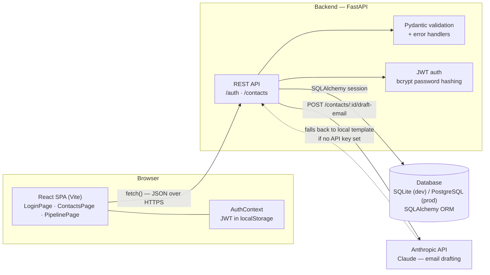

# Mini CRM Web App with AI Assist

A full-stack CRM: contacts management, a drag-and-drop deal pipeline, and an
AI button that drafts follow-up emails.

## Structure
- `backend/` — FastAPI REST API (JWT auth, contacts CRUD, AI email drafts, PostgreSQL/SQLite). See `backend/README.md`.
- `frontend/` — React (Vite) UI: login/signup, contacts table with search, Kanban pipeline, AI draft modal. Talks to the backend over real HTTP calls (`frontend/src/api.js`).

## Architecture





**Flow:** the React SPA never talks to the database or Claude directly — every action goes through the FastAPI REST layer, which validates the request, checks the JWT, then reads/writes Postgres (or SQLite locally) via SQLAlchemy. The one exception is the AI draft button, where the backend calls the Anthropic API on the contact's behalf and falls back to a stage-based template if no key is configured.

## Run both together

**Backend** (port 8000):
```bash
cd backend
python3 -m venv venv && source venv/bin/activate
pip install -r requirements.txt
cp .env.example .env   # set SECRET_KEY at minimum
uvicorn app.main:app --reload
```

**Frontend** (port 5500):
```bash
cd frontend
npm install
cp .env.example .env   # VITE_API_URL, defaults to http://localhost:8000
npm run dev
```

Open http://localhost:5500 — sign up, add contacts, drag cards between pipeline
stages, and click "AI draft" on any contact. Set `ANTHROPIC_API_KEY` in the
backend's `.env` to get real AI-generated drafts instead of the template
fallback.

Both halves were built and tested together end-to-end (build, run, and a full
signup → contact → drag-and-drop → AI-draft call sequence) before packaging.
